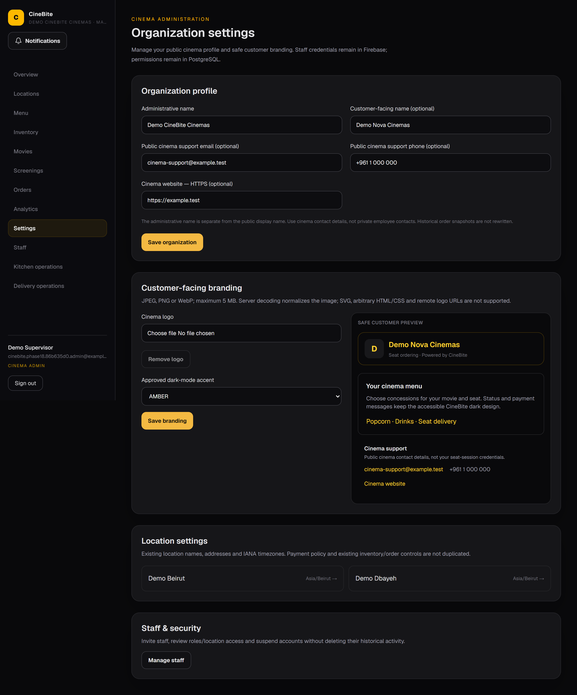
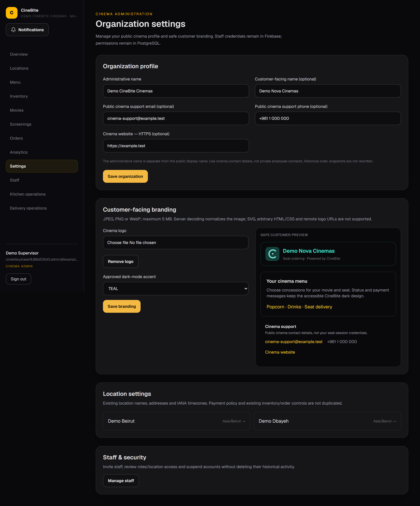
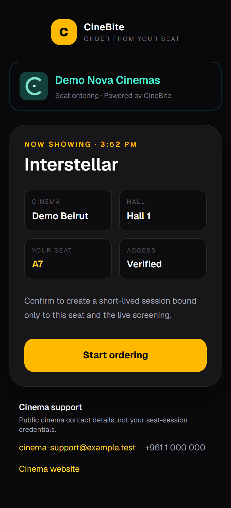
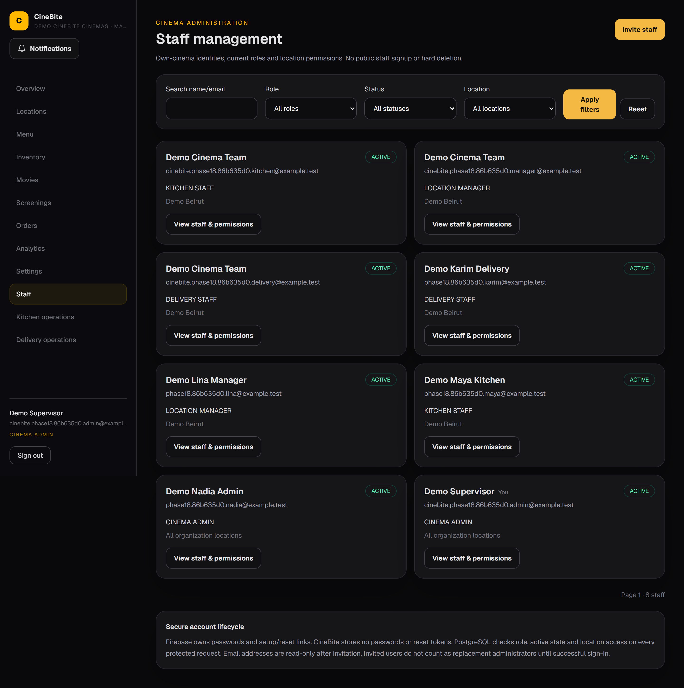
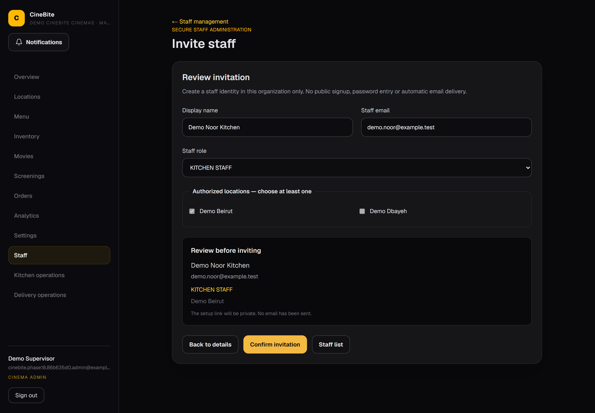
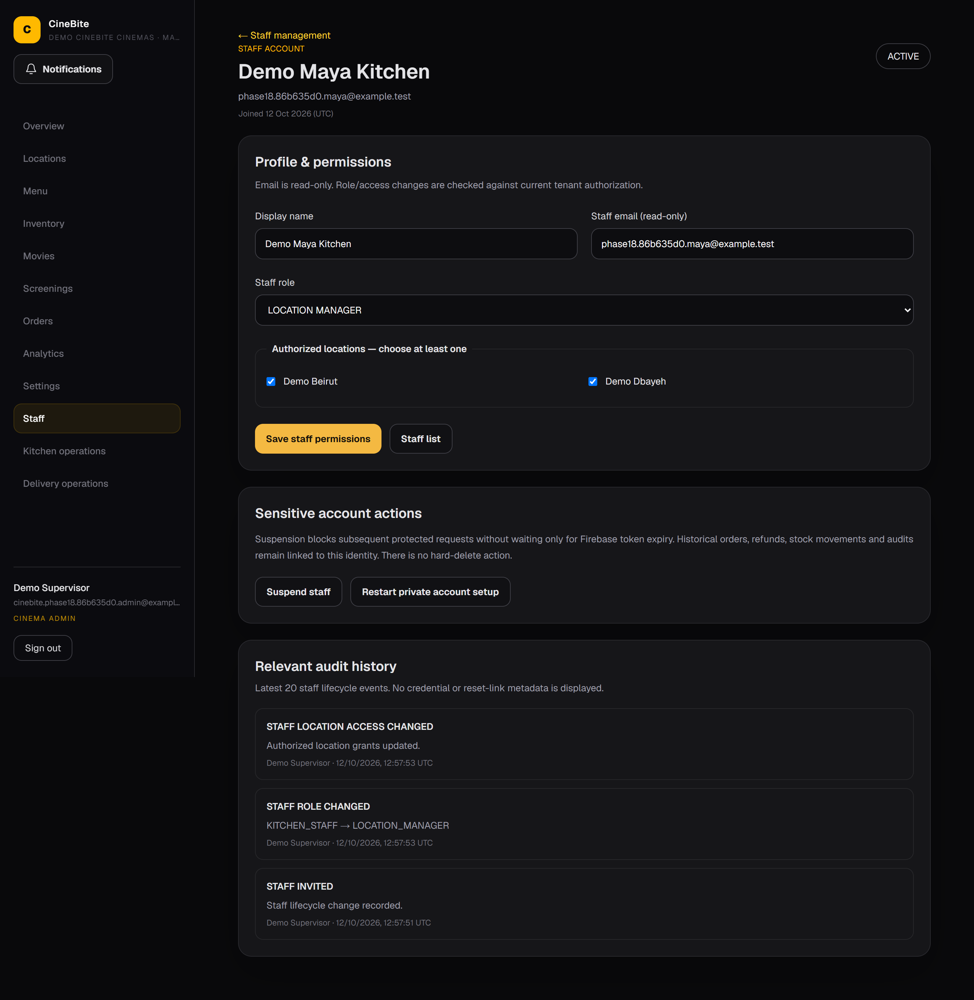
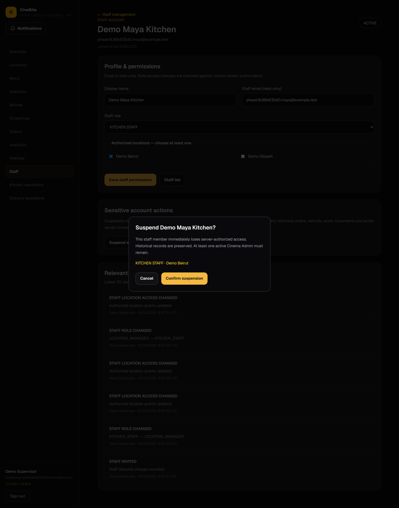
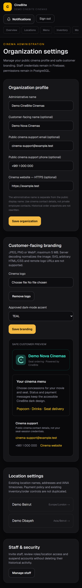

# Phase 18 — Organization Settings & Staff Management

Real CineBite pages captured with fictional identities/public cinema contacts in isolated PostgreSQL and official Firebase Auth/Storage emulators. Desktop viewport: 1440 CSS pixels; mobile: 390 × 844 CSS pixels. Native browser pixel density is 2× for clearer originals (2880px desktop / 780px mobile width); files are not upscaled, composited, blurred or reconstructed. Full-page capture retains the complete app content, including below-the-fold settings/history, while excluding desktop/taskbar/browser chrome. A deliberate suspension dialog darkens the background as the actual app does.

Phase 18 separates administrative and public cinema names, validates public support contacts and controlled dark accents, safely normalizes logos to WebP, previews customer branding and reuses existing location fields. Staff management keeps Firebase as identity/credential provider and PostgreSQL as current authorization. Invitations use private Firebase setup links, not public signup or stored passwords. Role/location grants, suspension/reactivation, last-active-admin protection, safe audits and optimistic concurrency are enforced server-side. Role/access changes reuse the Phase 17 durable notification layer; in-app alerts do not replace setup-link delivery.

## 01 — Organization profile

## 02 — Safe branding controls

## 03 — Branding applied to seat scan

## 04 — Staff management

## 05 — Invitation review

## 06 — Role and location access

## 07 — Explicit suspension confirmation

## 08 — Complete mobile settings

All addresses ending `example.test`, staff names and the placeholder cinema phone are synthetic test data; no real personal contacts are shown. No Firebase UID/token/key, setup/reset URL, QR credential, session token, database connection or provider secret is visible. A private setup-link dialog is explicitly excluded from capture. No production invitation email delivery is claimed. See [executed evidence](../../docs/phase-18-integration-results.json) and [architecture](../../docs/phase-18-architecture.md).
