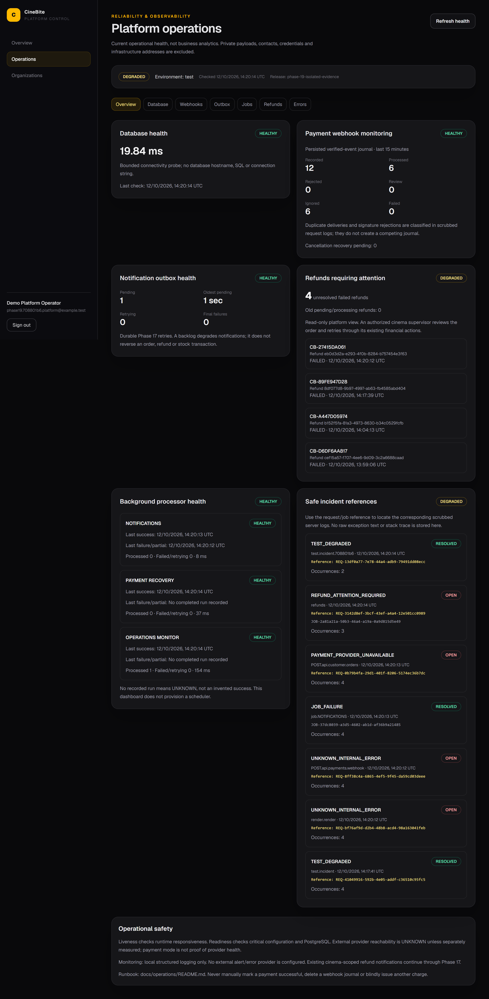
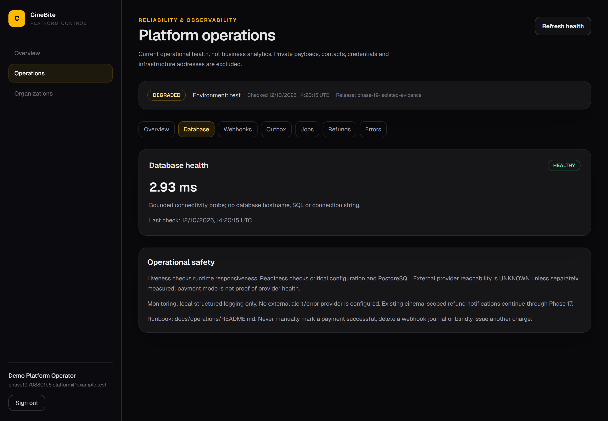
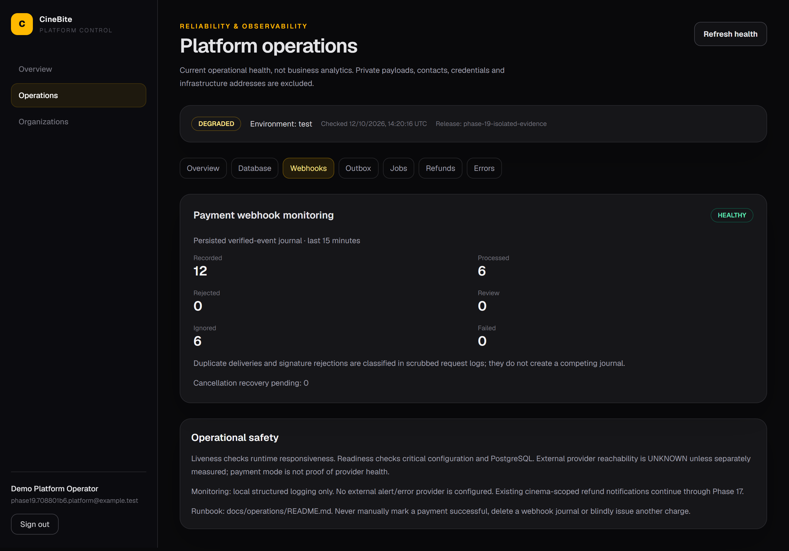
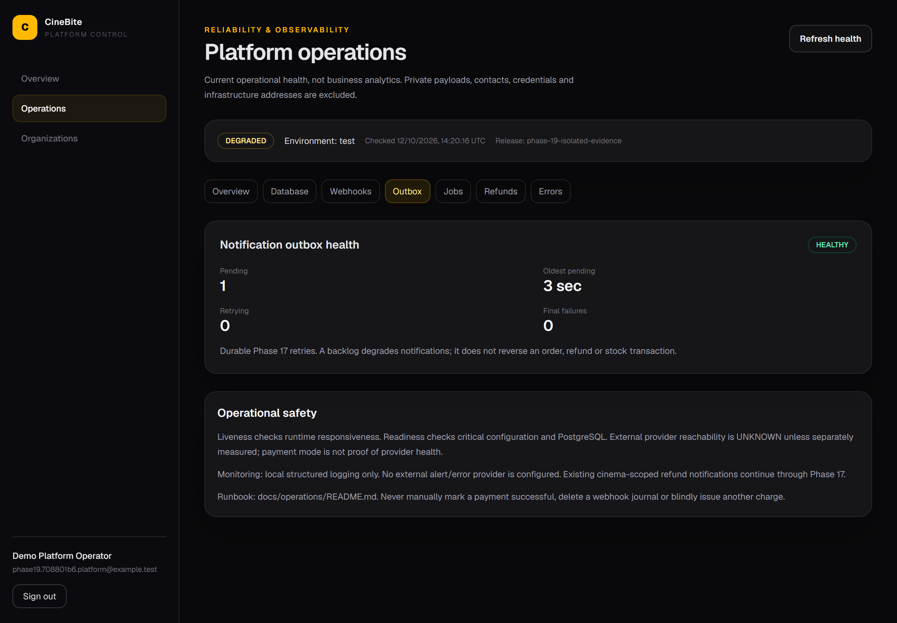
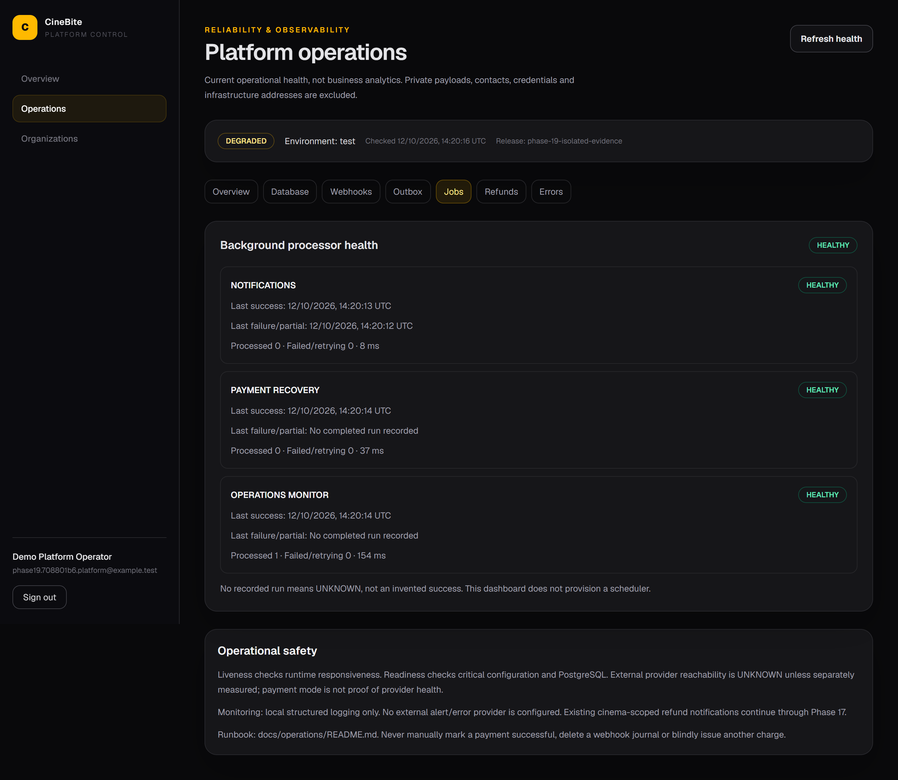
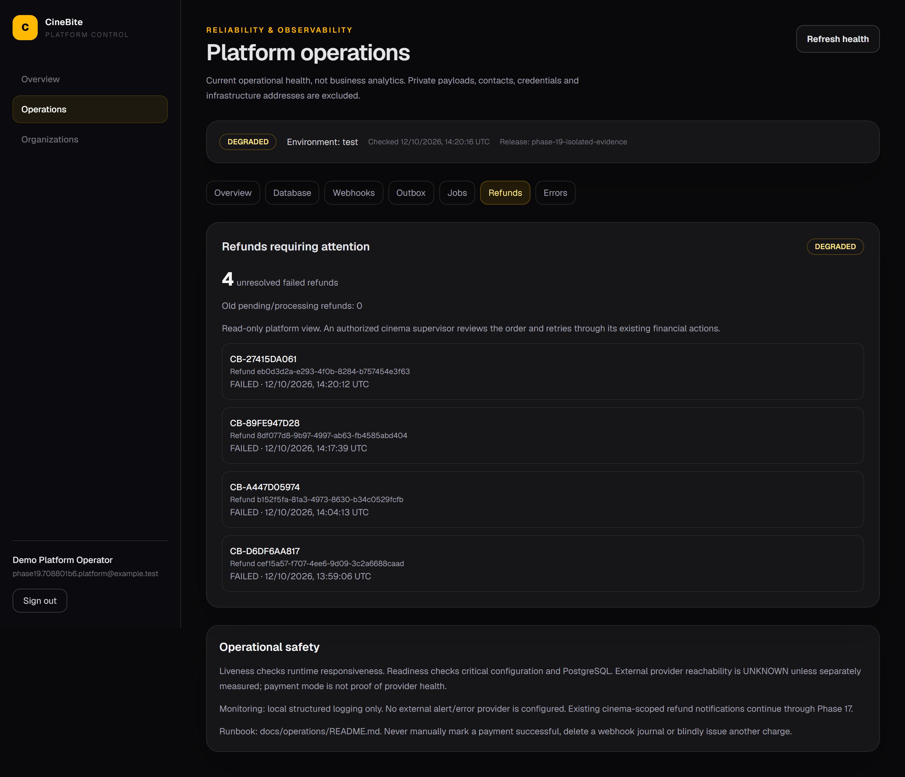
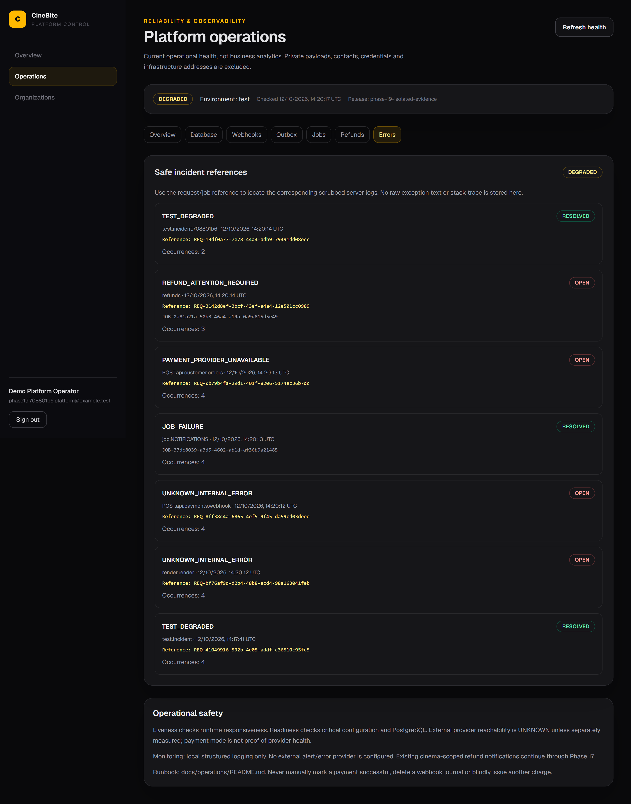

# Phase 19 — Reliability & Observability

Real CineBite pages from the isolated PostgreSQL/Firebase emulator/sandbox test environment—not generated dashboard artwork. The phase adds structured JSON logging, request/job correlation, safe normalization/recovery, liveness/readiness, database probing, existing webhook/refund/outbox monitoring, JobRun/incident diagnostics and a current Super Admin-only operations page.

The examples intentionally include synthetic degraded/failure/recovery states. They demonstrate diagnosis, not real production outages or unresolved application bugs. External error/alert delivery is not configured or claimed; local logging and safe provider seams are implemented. [Operational runbook](../../docs/operations/README.md).

All captures are native app-only **full pages**, excluding desktop, taskbar, browser chrome, unrelated tabs, terminal, editor and DevTools. DPR2 produces 2880px desktop and 780px mobile originals; no artificial enlargement, cropping away lower content, compositing or blur was applied. Some complete mobile pages are long: view the original at full width for readable text.

## 01 — Full platform operational dashboard with real isolated health and synthetic incident records\n\n\n\n## 02 — Measured test database latency/status without private host, URL or SQL\n\n\n\n## 03 — Existing verified sandbox webhook journal states and cancellation backlog\n\n\n\n## 04 — Actual pending age, retries/final failures and notification health\n\n\n\n## 05 — Durable processor health with last success/failure and correlated run counts\n\n\n\n## 06 — Actual synthetic FAILED sandbox refunds requiring authorized review\n\n\n\n## 07 — Safe request/job references connecting synthetic failures to private structured logs\n\n\n\n## 08 — Complete responsive 390px operational view, with all cards and safe references\n\n

Only fictional reserved-domain platform contacts and test business records appear. Request/job/public-order references are diagnostic IDs, not credentials. No authorization/cookie header, Auth/session/QR token, private key, setup URL, database host/connection string, provider secret/payload, raw log or exception stack is shown.

[Actual per-case evidence](../../docs/phase-19-integration-results.json) · [75-topic architecture](../../docs/phase-19-architecture.md) · [Verification](../../docs/phase-19-verification.md).
